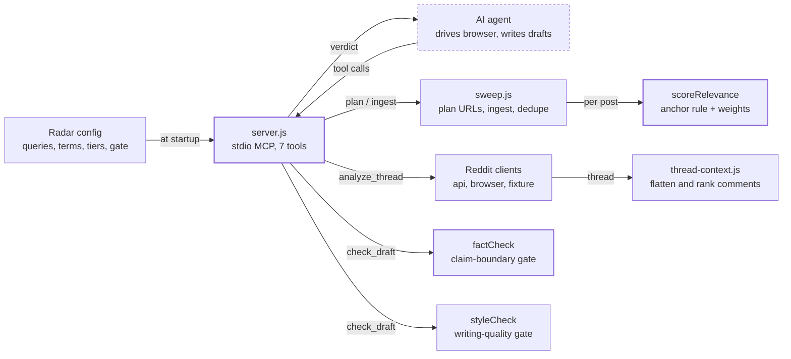

# reddit-radar-mcp: design notes

It finds threads where a product genuinely fits, rebuilds the conversation, and refuses to return a drafted reply that breaks a claim boundary you define. It never posts.

## In short

Promotional replies written by an AI tend to overclaim. This MCP server puts a deterministic gate in the way. Posts are scored with an additive, explainable formula. Drafts go through a rule-based fact check and a style check, and the server only returns the draft text if it passes. It is read-only by construction: there is no tool or client method that writes, and a test fails CI if one ever appears.

## Architecture

The agent's own browser loads Reddit pages; the server only scores and checks. A draft comes back only when both gates pass.

## From sweep to approved draft

1. `plan_sweep` builds search URLs from the configured queries and subreddits and returns a small extractor function as text. The server fetches nothing.
2. The agent's own browser tool loads those pages and runs the extractor.
3. `ingest_sweep` dedupes posts by id, resolves each subreddit's tier, and scores each post's title with `scoreRelevance`.
4. `score_thread` scores one post and returns the per-signal reasons and any blockers.
5. `analyze_thread` fetches a thread, flattens and ranks its comments, and returns context plus the rules. It never returns a draft.
6. `check_draft` auto-fixes quotes and dashes, then runs `factCheck` and `styleCheck`.
7. If any fact rule blocks or any style rule fails, the result is BLOCKED and the draft text is left out. Otherwise the text is returned as approved.

## Libraries

| Library                     | Used for                                                            |
| --------------------------- | ------------------------------------------------------------------- |
| `@modelcontextprotocol/sdk` | `McpServer` over stdio with seven registered tools.                 |
| `zod`                       | Tool input schemas.                                                 |
| `node:test`                 | 33 tests, plus a smoke script that drives the server over the wire. |
| `(no build step)`           | Plain ES-module JavaScript.                                         |

## Design decisions and trade-offs

### Rules, not a model, decide what passes

The gate is regular expressions and sentence-level checks.

**Trade-off:** Deterministic, cheap, testable in CI and every finding has evidence. It misses paraphrases and can false-positive.

### The anchor rule

Bonuses for recency, question form, intent and features apply only if the post is anchored by domain vocabulary, an unambiguous query or a configured subreddit.

**Trade-off:** Stops any recent question from scoring well on shape alone. A relevant post with unusual wording can be missed.

### Only assertions about the product are checked

A sentence is scanned only if it has the product (or `it`, `we`) near a capability verb, and no denial word.

**Trade-off:** Mentioning a competitor's feature does not trigger it. Any negation in a sentence exempts the whole sentence.

### Read-only by test

A safety test fails if any client has a write-style method, any file references a write endpoint, or any export starts with post, submit, comment or vote.

**Trade-off:** A strong guard against drift. It is a regex heuristic over `src/` only.

### The server does not fetch search pages

It hands the agent an extractor; the agent's browser does the loading.

**Trade-off:** No Reddit API approval needed. It depends on Reddit's page structure.

### The gate is enforced, not advisory

`check_draft` runs server-side and omits the text when blocked.

**Trade-off:** It cannot stop the agent showing its own copy of the draft.

## Relevance score (additive, clamped 0 to 100, pass at 40)

- Domain vocabulary +30; query match +20 (only without a domain hit); configured subreddit +20.
- Posted within 7 days +15, within 30 days +8; question-form title +15.
- Intent or commercial wording +10; feature match +10; pain +5; software context +10.
- No software context −20; venting −35.
- Hard blockers: locked, archived, removed or NSFW.

## The fact gate has three parts

- Each configured rule is tested against the whole draft.
- Unsupported capabilities: each assertive sentence about the product is checked against a list of things the product does not do.
- Disclosure: naming the product without a disclosure phrase is a block.

## Numbers

- **Tools:** 7
- **Tests:** 33, plus 14 wire-level smoke checks
- **Scoring weights:** 13
- **Rule packs:** 5
- **Source:** about 3,150 lines
- **CI:** 3 operating systems × Node 20, 22, 24

## Design FAQ

### Why a rule-based gate and not an LLM?

The model that wrote the promotional copy shares the incentive to overclaim. A deterministic check is cheap, testable in CI and explains each finding. The cost is missed paraphrases and some false positives.

### How is it read-only by construction?

No tool or client method writes, the only POST is the OAuth token call, and a test fails CI if a write method, endpoint or export appears.

### What is the anchor rule, and why?

Shape signals such as recency and question form could push any recent post past the threshold. They count only when domain vocabulary, an unambiguous query or a configured subreddit ties the post to the domain.

### How are denials handled?

A sentence with a denial word is skipped, so 'we don't support Jenkins' passes. The simplification is that any negation exempts the sentence, so a mixed sentence could slip through.

### How does it reach Reddit without API approval?

The agent's own browser loads public pages and runs the returned extractor; the server only scores the rows. That breaks when Reddit changes its page structure.

## Known limitations

- Scoring reads `config.subreddits`, but the README and examples define only `tiers.*.subreddits`. With a tiers-only config the subreddit bonus never fires.
- `analyze_thread` works only in live mode. The default mode is `fixture`, and no fixtures ship with the package.
- Sweep scoring looks at titles only.
- No persistence; the caller supplies the list of posts already seen.
- No semantic scoring.
- Competitor detection from config appears inert in the server.
- Dormant since its release day.

---

Written from the source code as it stood on 26 November 2026.
